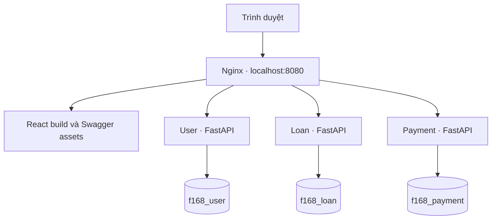

# F168 · Đọc source Foundation và chuẩn bị vấn đáp

Bắt đầu bằng một câu hỏi: **khi trang chủ báo Loan Service “Sẵn sàng”, ai đã kiểm tra điều đó?** Mở trang chủ, nhấn **Kiểm tra lại**, rồi lần lượt đọc các file bên dưới. Toàn bộ đường đi này đã có trong Phase 1.

## 1. Phần chung — từ trình duyệt đến PostgreSQL

Ba mũi tên xuống DB là ba kết nối riêng. Trong Compose, mỗi DB nằm trên một mạng storage riêng với service sở hữu nó. Ba backend và Gateway cùng tham gia mạng service. PostgreSQL chỉ lắng nghe bên trong cụm. Khi tới nghiệp vụ, Loan xác minh account qua REST tới User; Payment đọc email từ User và gọi Loan để validate/settle. Hai mũi tên liên service này là công việc Phase 3–4.

| Thứ tự đọc | File và điểm dừng | Theo dõi điều gì? |
|---|---|---|
| 1 | [App.tsx](../frontend/src/App.tsx), `ServiceRow` và `check` | Với dòng Loan, biến `service.id` bằng `loan`. Browser gọi GET `/health/loan`. Mỗi dòng có state riêng. |
| 2 | [nginx.conf](../infra/nginx.conf), `location = /health/loan` | `proxy_pass` chọn upstream `loan_api`. Trong mạng Compose, địa chỉ đích là `loan-service:8000`. Gateway chuyển tiếp request ID. |
| 3 | [main.py](../services/loan_service/app/main.py), `health` | FastAPI ghép endpoint với dependency `get_db`; tham số `db` là một SQLAlchemy Session của Loan. |
| 4 | [dependencies.py](../services/loan_service/app/dependencies.py), `get_db` | `with SessionLocal() as session` tạo session riêng. `yield` trao nó cho endpoint. Khi request xong, thoát khối with và trả kết nối về pool. |
| 5 | [database.py](../services/loan_service/app/database.py), [config.py](../services/loan_service/app/config.py) | `engine` nhận URL được tạo từ host, port, user, password và DB name của Loan. Password lấy từ env, URL.create xử lý phần mã hóa. |
| 6 | Quay lại `health` và [schemas.py](../services/loan_service/app/schemas.py) | Query `SELECT 1` nhận giá trị 1 từ DB. Hàm trả `HealthResponse(service="loan", status="ok", database="ok")`. Browser kiểm tra cả ba trường rồi đổi state sang ready. |

**DB trước và sau.** Trước request, schema nghiệp vụ trống. `SELECT 1` trả một giá trị, không thêm hay sửa dòng. Sau request, schema vẫn trống. Vì vậy health không có bước commit nghiệp vụ. Khi truy vấn ném `SQLAlchemyError`, hàm rollback session lỗi và trả 503. Browser vẫn có thể báo User và Payment sẵn sàng.

**Khi app vừa khởi động.** FastAPI vào `lifespan` → `initialize_database` mở kết nối, chạy `SELECT 1` và `Base.metadata.create_all`. Khối `engine.begin()` tự kết thúc transaction khi thành công hoặc rollback khi lỗi. Metadata hiện chưa có model nghiệp vụ. Nếu kết nối đầu tiên thất bại, startup thất bại. Đây là lý do Compose đợi `pg_isready` của DB trước, rồi dùng health HTTP để kiểm tra cả quyền đăng nhập DB của app. Ngay cả sau startup, health vẫn truy vấn lại DB ở từng lượt.

**Truy vết lỗi.** Trong [errors.py](../services/loan_service/app/errors.py), `trace_request` nhận hoặc tạo mã request, đo thời gian, ghi service/method/status và gắn ID vào response. Dùng lệnh `Select-String` trong README để tìm cùng ID tại hai nơi. Lỗi trả `error.code/message/details/request_id`. Log tránh body, query string thô và giá trị exception. Đường dẫn internal public bị Gateway chặn trước FastAPI, vì vậy response 403 chỉ có ID của Gateway và không có header `X-Service-Name`.

**Thử đọc hai kết quả gần giống nhau.** Gọi `/api/v1/loans` hôm nay nhận 404 từ Loan, mã `NOT_FOUND` và header service. Gọi `/api/v1/missing` nhận 404 ngay từ Nginx, mã `ROUTE_NOT_FOUND`. Hai lệnh xác nhận được cả phân công route và việc chức năng Loan chưa triển khai.

**Liên hệ Unit.** Unit 19 minh họa hai service độc lập gọi REST; nhóm có thể chỉ ra process, URL và chủ DB tương ứng trong F168. Unit 21 nằm ngay trong Compose, Dockerfile và cách phân giải service name. Unit 18 sẽ áp dụng khi User cấp JWT và kiểm tra role. Unit 20 sẽ áp dụng cho SMTP, lỗi phụ thuộc và hành vi retry. [Đường dẫn bài giảng](IMPLEMENTATION_PLAN.md#đối-chiếu-bài-giảng).

## 2. Lộ trình A — Loan, JWT, Login và Profile

**Đọc được ngay.** Mở [test_foundation.py của Loan](../services/loan_service/tests/test_foundation.py). `test_database_identity_and_version` hỏi PostgreSQL tên DB hiện tại, đối chiếu `f168_loan` và kiểm tra phiên bản 16. `test_health_uses_real_postgres` đi qua lifecycle và session thật. So sánh `SERVICE_NAME` trong Loan với [config của User](../services/user_service/app/config.py). Dù hai service dùng cùng kiểu code, chúng có process, metadata, mật khẩu DB và vòng đời độc lập.

**Bài thực hành.** Trước khi dừng Loan DB, đo `/health/loan`. Dùng lệnh ở README để dừng DB, đo lại Loan và User rồi phục hồi. Điểm cần giải thích khi vấn đáp: Nginx còn sống, Loan vẫn nhận HTTP nhưng truy vấn DB lỗi. Vì vậy response 503 này từ Loan có mã `DATABASE_UNAVAILABLE`. Nếu dừng hẳn Loan API, Nginx tự trả `SERVICE_UNAVAILABLE`.

**Lộ trình tiếp theo theo SPEC — chưa có code nghiệp vụ.**

| Mốc | Luồng A sẽ bổ sung và học | Ví dụ để kiểm tra hiểu đúng |
|---|---|---|
| Phase 2 | Form login → account ACTIVE/verified → kiểm tra hash → JWT HS256 → dependency role/profile. Bàn giao contract với B. | Đăng ký xong mà email chưa verify: account chưa đủ điều kiện login. |
| Phase 3 | Models/schemas Loan → schedule dùng chung cho preview và tạo loan → approval, snapshot → flush IDs → commit cả bộ hoặc rollback → router/HTTPX xác minh User. | 12 triệu / 12 tháng, rate “0.12”: gốc kỳ đầu 1 triệu, lãi 120.000, tổng 1.120.000. Cuối kỳ đầu còn 11 triệu. |
| Phase 3–4 | Settlement khóa loan rồi kỳ → kiểm tra operation và owner → đánh dấu PAID → giảm riêng gốc → lưu snapshot → commit. | Cùng operation được replay theo snapshot. Operation mới gặp kỳ đã trả phải conflict, dư nợ không giảm thêm. |
| Phase 5–7 | UI gói/preview/đơn/My Loans/Admin, các test rate/date/rollback, C1/C2/C3, phần diagram và demo Loan. | Giải thích vì sao hai kỳ khác nhau vẫn cần khóa chung trên hàng loan. |

## 3. Lộ trình B — Payment, Register, OTP và SMTP

**Đọc được ngay.** Mở [main.py của Payment](../services/payment_service/app/main.py) và [test_gateway.py](../tests/test_gateway.py). Tìm `test_reserved_resource_reaches_owner`. Request `/api/v1/payment-transactions` đã đến đúng process; test kiểm tra header `X-Service-Name: payment` và ID người gọi truyền vào. Mở [test_foundation.py của Payment](../services/payment_service/tests/test_foundation.py), xem cách test 422/500 bằng app chỉ dùng cho test. Lỗi trả về và log đều không lộ chuỗi đầu vào thử nghiệm.

**Bài thực hành.** Gọi `/health/payment` rồi gọi `/api/v1/internal/installments/example` qua cổng 8080. So sánh nơi tạo response, mã lỗi và request ID. Khi xây Payment, client nội bộ sẽ dùng hostname Loan trong mạng Compose và `X-Internal-Token`; frontend luôn dùng Gateway.

**Lộ trình tiếp theo theo SPEC — chưa có code nghiệp vụ.**

| Mốc | Luồng B sẽ bổ sung và học | Điểm kiểm tra khi vấn đáp |
|---|---|---|
| Phase 2 | Register + profile → khóa user, kiểm tra giới hạn → tạo challenge → commit → Gmail SMTP → verify/resend. | Nếu gửi lỗi thì vô hiệu đúng challenge bằng transaction mới. Nếu nhập sai, attempts phải được commit. |
| Phase 4 | Kiểm tra account/kỳ qua User/Loan → khóa advisory theo user → OTP thanh toán → verify dưới row lock và cấp authorization 5 phút. | Giới hạn resend tính chung các kỳ của user; đổi kỳ không làm quota bắt đầu lại. |
| Phase 4 | Tìm giao dịch cũ bằng key/fingerprint → với giao dịch mới khóa vé, xóa hai cột authorization và tạo PENDING trong cùng commit → cấp attempt → gọi Loan với operation_id. | Retry cùng key/payload tìm được giao dịch dù vé đã dùng. Cùng key mà đổi vé gây 409. |
| Phase 4–7 | Retry, reconcile, history → UI thanh toán/lịch sử/Admin → test C4/C5 và demo. | Loan có thể đã commit trước khi Payment timeout. Giữ operation_id, đối soát lại rồi mới kết luận trạng thái. |

### Cả hai ghép luồng thanh toán ở các phase sau

User xác minh danh tính và email bằng OTP/JWT. Payment quản lý vé, giao dịch và lượt gọi. Loan là nơi duy nhất thay đổi kỳ và dư nợ. Trong ví dụ kỳ đầu 1.120.000 đồng, Payment lưu số tiền thanh toán 1.120.000, còn Loan giảm 1.000.000 đồng gốc. Hai DB commit độc lập, nên Payment phải giữ căn cứ để retry đúng operation.

| Case | A quan sát tại Loan | B quan sát tại Payment/User |
|---|---|---|
| C1 · hai operation khác nhau, cùng kỳ | Một PAID; operation khác conflict; gốc giảm một lần | B cùng A gọi trực tiếp internal API trong môi trường test để tranh chấp thực sự đến Loan |
| C2 · hai kỳ đến hạn cùng loan | Cả hai PAID; dư nợ giảm tổng hai phần gốc | Đối chiếu hai kết quả độc lập |
| C3 · hai đơn đồng thời | Một ACTIVE, đơn còn lại REJECTED; không orphan | Kiểm tra account của cùng user và kết quả API |
| C4 · hai request cùng key/vé | Cùng operation không trừ hai lần | Một giao dịch logic, một lần consume vé, kiểm tra fingerprint |
| C5 · mất phản hồi sau Loan commit | Replay trả snapshot cũ | PENDING hoặc REQUIRES_RECONCILIATION → reconcile cùng operation → SUCCESS |

Danh sách này định hướng cho buổi học và test về sau. [Báo cáo hiện tại](TEST_REPORT_PHASE1.md) chỉ ghi kết quả Foundation.
