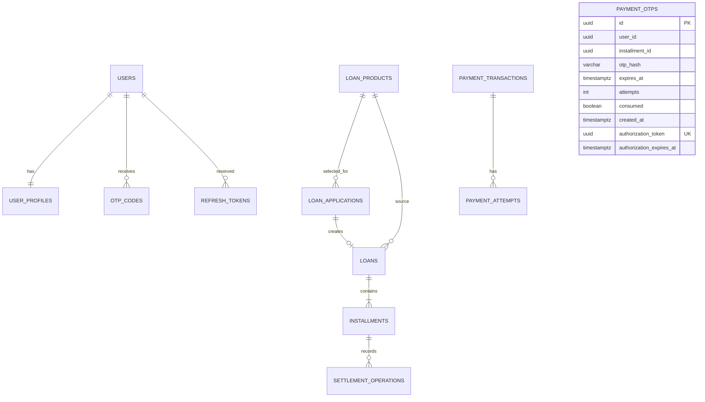
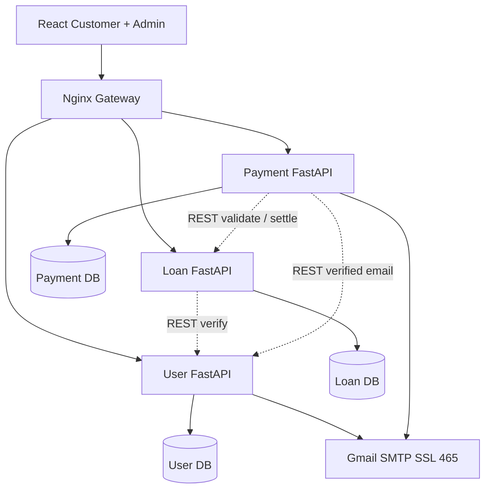

# PROJECT_SPEC.md — F168 Loan Installment

**Phiên bản:** v1.2 — Final SSOT
**Trạng thái:** Baseline cuối cùng được nhóm phê duyệt: kế thừa v1.0/v1.1 và tích hợp đủ 17 quyết định T01–T12, Bổ sung 1–5. Chưa phải bằng chứng source đã chạy hoặc test đã PASS.
**Ngày:** 24/11/2026  
**Repository:** https://github.com/ridofu0212-cyber/soa (`main`)  
**Đối tượng:** Hai thành viên nhóm và ChatGPT Work mode.

**SSOT:** v1.2 thay thế v0.1/v1.0/v1.1 và là đặc tả độc lập để bàn giao Work mode. Thứ tự ưu tiên: quyết định mới nhất được nhóm xác nhận → SPEC này → `F168_BUSINESS_RULES_ERD_API.md` → `F168_PROJECT_PLAN.md` và `IMPLEMENTATION_ROADMAP.md`. `Loan_Pay(1).zip` (Loan_Pay.zip cũ) chỉ tham khảo, không phải source chính thức. Không thêm feature, bảng, framework hoặc service ngoài baseline. Các lựa chọn triển khai chưa định lượng được ghi và kiểm chứng theo §7.4, không tự coi là quyết định nghiệp vụ đã phê duyệt. Nếu thiếu môi trường hoặc quyết định thực sự ảnh hưởng nghiệp vụ/bảo mật/contract đã chốt, ghi BLOCKED cho phần phụ thuộc, tiếp tục phần độc lập. Không đổi baseline để giảm số dòng code.

## 1. TỔNG QUAN DỰ ÁN

### 1.1. Mục tiêu và phạm vi

F168 (Loan Installment) là ứng dụng web mô phỏng vay và thanh toán trả góp cho đồ án Kiến trúc Hướng Dịch vụ (SOA). Theo xác nhận của nhóm, giảng viên cho phép chọn đề tài tự do miễn đáp ứng FastAPI microservices, luồng thanh toán, OTP/email thật và kiến thức Unit 18–21. Không xây hệ thống học phí; ánh xạ yêu cầu kỹ thuật rubric sang nghiệp vụ vay trả góp.

**Mục tiêu điểm:** 9.0–9.5+ (không cam kết điểm). **Bản base:** MVP full-stack chạy được, triển khai tuần tự Phase 1–7, không chỉ skeleton. Mục tiêu học tập ngang với mục tiêu chạy được: sinh viên hiểu từng dòng code nghiệp vụ phụ trách và giải thích được giao tiếp liên service.

Luồng Customer: register → email OTP → login → xem gói/preview → nộp đơn → auto-approval → loan + lịch kỳ → chọn kỳ đến hạn → OTP thanh toán → authorization → thanh toán mô phỏng → cập nhật kỳ/dư nợ → lịch sử. Admin quản lý gói vay và theo dõi đơn, loan, kỳ và giao dịch.

Giữ đúng 3 microservice FastAPI (User, Loan, Payment), 3 PostgreSQL DB, 12 bảng, REST, Nginx, React, Docker Compose, validation, phân quyền, consistency/concurrency, idempotency, recovery, tests và docs. OTP đăng ký và thanh toán gửi email thật; không chuyển/giải ngân tiền thật.

Ngoài v1: AI/chatbot, CIC, ngân hàng/ví/cổng thanh toán thật, số dư ví Account hoặc thanh toán hộ như LoanPay cũ, duyệt thủ công, trả trước hạn, thanh toán một phần, phí dịch vụ/phạt trễ hạn, báo cáo tài chính/quản trị nợ nâng cao, Admin quản lý user, refresh token flow (giữ bảng). Không bổ sung notification microservice hay message broker.

### 1.2. Tham chiếu LoanPay cũ và nguyên tắc đơn giản hóa

Đã kiểm tra hai ZIP. `soa-main.zip` (commit `39a7a61fbdd55670df9dfe47ee5eba1874645b50`) chỉ có ba docs, không chứa implementation. `Loan_Pay.zip` là ứng dụng tham khảo riêng: Loan Django, Payment FastAPI, 2 DB, Nginx, frontend HTML/CSS/JS, MailHog/debug OTP, code và tests. Chưa chạy/kiểm chứng ZIP cũ. Trước khi sửa repo thực tế, kiểm tra branch/cây thư mục, không ghi đè code đồng đội.

| Nguồn LoanPay | Giữ ý tưởng | Không mang nguyên sang F168 |
|---|---|---|
| `loan_service/core/schedule.py` | Hàm tính lịch và ngày đến hạn độc lập, dễ test | Annuity, cách biểu diễn rate % cũ; thay Equal Principal, rate tỷ lệ 0.12 |
| `loan_service/core/services.py` | Nghiệp vụ tập trung, local transaction/row lock | Django ORM, atomic decorator, Account/số dư ví, payer thanh toán hộ, lock Installment→Account |
| `payment_service/app/loan_client.py` | REST client rõ, timeout, request ID | Route `/internal/settle`, X-Internal-Key; dùng contract `/api/v1` và X-Internal-Token mới |
| `payment_service/app/routers/payments.py` | OTP, vòng đời giao dịch, retry, history | API và trạng thái cũ, nghiệp vụ trong router dài; tách nghiệp vụ sang service functions |
| Compose, Nginx, tests/docs | Chạy nhiều service, gateway, kiểm thử concurrency | Django, PyJWT, frontend JS thuần, MailHog/debug OTP, secret mặc định không an toàn |

Không chọn kiến trúc 2 service để giảm số file: User Service riêng giúp Loan chỉ tập trung công nợ và Payment chỉ tập trung quy trình thanh toán. Tất cả backend dùng cùng FastAPI/SQLAlchemy; cấu trúc thống nhất, ít tầng, không nhiều class trung gian. Không bê nguyên code LoanPay hoặc sửa baseline để khớp code cũ.

### 1.3. Rubric và mục tiêu nghiệm thu

| Mức | Minh chứng trên F168 |
|---|---|
| 5–6.9 | DB, API, UI, microservices và payment workflow cơ bản chạy được |
| 7–7.9 | Login, tra cứu khoản/kỳ, OTP/email, thanh toán, cập nhật, history, service giao tiếp thật, validation/error handling |
| 8–8.9 | Consistency, thiết kế microservices đúng, demo ít nhất 2 case concurrency ở §4.7 |
| 9–9.5 | Đạt mức 8, code quality, ownership, API docs, automated tests, Docker, giải thích thiết kế |
| 10 | Chất lượng nổi bật, ví dụ E2E/integration, idempotency, API Gateway, logging/tracing và bảo vệ xuất sắc |

Giới hạn rubric: không chạy/demo 4.0; chỉ monolithic 6.5; thiếu OTP 7.0; thiếu transaction/concurrency 7.5; thiếu Microservices Architecture Diagram 8.0. Chỉ tính minh chứng thực tế, không coi docs hoặc thiết kế là đã triển khai.

## 2. TECH STACK & RÀNG BUỘC KỸ THUẬT

### 2.1. Tech stack chính thức

| Thành phần | Quyết định đã chốt |
|---|---|
| Backend (cả 3 service) | Python 3.13 + FastAPI Sync (`def` cho DB/HTTP/SMTP blocking), Pydantic, Swagger/OpenAPI |
| ORM/driver | SQLAlchemy 2.0 Sync + psycopg2-binary |
| DB | PostgreSQL 16, 3 DB độc lập |
| Khởi tạo schema | `Base.metadata.create_all()` + `seed.py`, không Alembic |
| JWT | `python-jose[cryptography]`, HS256, 60 phút, OAuth2PasswordBearer; `get_current_user`, `require_admin` |
| Mật khẩu/OTP | `pwdlib[argon2]` |
| Refresh token | Không triển khai, giữ bảng ERD |
| Internal API | HTTPX Sync (`httpx.Client`), timeout 5s, X-Internal-Token |
| Email | `smtplib` + `ssl` + `email.message`, Gmail SMTP SSL 465, App Password |
| Frontend | React + TypeScript + Tailwind + Vite; useState/useEffect/Context |
| Mobile/Desktop | Không có app native |
| Gateway/Deployment | Nginx + Docker Compose v2 |
| Testing | Pytest + HTTPX + PostgreSQL thật; Postman hỗ trợ manual testing |
| Logging | Python logging + X-Request-ID, correlation log qua services |
| Kiến trúc | Simple Layered Architecture, xem §6 |
| Quản lý mã | Git/GitHub |

Không Django, Flask, Node backend, AsyncSession, async DB, BaseRepository, generic service framework, Redis, Celery, RabbitMQ, Kafka, Kubernetes, service mesh hoặc tracing framework. Không dùng PyJWT của LoanPay cũ. Backend dùng pip + requirements.txt; frontend dùng Node 22 tương thích Vite, npm + package-lock.json. Chọn các phiên bản package cụ thể tương thích, kiểm thử và khóa chúng trong Phase 1 (chi tiết triển khai, không tự nhận đã kiểm chứng).

### 2.2. Quy chuẩn runtime và bảo mật

- SQLAlchemy 2.0 `select()`, `Session.execute()`, `with_for_update()`, `flush()`, `commit()`, `rollback()` tường minh. Session riêng mỗi request, đóng sau xử lý; không chia sẻ threads. Sync FastAPI vẫn xử lý nhiều request đồng thời.
- Import models, chờ DB healthy rồi create_all khi startup; seed idempotent. create_all không ALTER bảng cũ: khi thay schema, hướng dẫn SQL cập nhật hoặc reset riêng DB demo/test có chủ đích, không auto drop_all hay xóa volume thật.
- UUID cho IDs; VND nguyên BIGINT; NUMERIC(10,6)/Decimal cho rate, rate API string như `"0.12"`; không float cho tiền. Timestamp TIMESTAMPTZ/ISO-8601 UTC; ngày nghiệp vụ lấy theo `Asia/Ho_Chi_Minh` và lưu due_date dạng DATE. Không dùng ngày UTC thay cho ngày nghiệp vụ Việt Nam.
- Config/credentials qua env; `.env.example` chỉ placeholder, `.env` không commit. JWT secret riêng Internal Token. Internal API chỉ trong private network, chặn ở Nginx, không frontend gọi. So sánh token nội bộ an toàn (ví dụ `hmac.compare_digest`). HS256 dùng secret chung cho xác minh; chỉ User cấp JWT theo thiết kế.
- Gmail, Admin, demo Customer và toàn bộ secrets cung cấp qua `.env` riêng; không đưa giá trị thật vào SPEC, GitHub, chat, test report hoặc log. `.env.example` gồm SMTP_HOST, SMTP_PORT, SMTP_USERNAME, SMTP_APP_PASSWORD, ADMIN_EMAIL, ADMIN_PASSWORD, DEMO_CUSTOMER_EMAIL, DEMO_CUSTOMER_PASSWORD, JWT_SECRET_KEY, INTERNAL_TOKEN và cấu hình kết nối DB/service cần thiết, chỉ placeholder cho bí mật. Không dùng secret mặc định yếu.
- Không log/hiển thị passwords, hashes, OTP, JWT, internal token, SMTP credentials hoặc authorization (ngoại lệ response cấp token hợp lệ). `X-Request-ID` truyền qua HTTPX; log thêm operation_id khi settle/retry, không ghi request body chứa secret. Không giữ row lock khi chờ HTTPX/SMTP nếu tránh được.

### 2.3. Liên hệ 4 Unit trọng tâm

| Unit | Nội dung áp dụng |
|---|---|
| 18 — JWT Authentication | pwdlib, python-jose, JWT Bearer, protected endpoints, dependency xác thực/phân quyền |
| 19 — Building and Communicating Microservices | 3 FastAPI services, database ownership, REST HTTPX sync, internal authentication |
| 20 — Integrating Third-Party Services | SMTP Gmail thật là tích hợp bên thứ ba (khác ví dụ provider REST), xử lý timeout/lỗi, idempotency |
| 21 — Containerizing and Deploying Microservices | Dockerfile, Docker Compose, service name/network, env, healthchecks |

Unit 22 chỉ tham khảo testing; automated tests vẫn bắt buộc theo rubric. Nội dung Unit 19 chưa xác minh toàn văn trong các lần truy xuất trước, không khẳng định chi tiết chưa đọc. Không sao chép nguyên ví dụ Product/Order/Notification thành feature mới. Gắn mã nguồn thực tế với Unit tương ứng trong CODE_WALKTHROUGH.

## 3. VAI TRÒ NGƯỜI DÙNG VÀ PHÂN CÔNG NHÓM

### 3.1. Roles & permissions của ứng dụng

| Actor | Quyền |
|---|---|
| Guest/Public | Register, verify/resend email OTP, login, xem gói ACTIVE và preview không ghi DB |
| CUSTOMER | Xem/sửa profile mình, logout, preview/nộp đơn, xem đơn/loan/kỳ của mình, OTP/thanh toán kỳ hợp lệ của mình, xem history/chi tiết giao dịch |
| ADMIN | Xem tất cả gói, tạo/sửa/bật-tắt gói; giám sát đơn, loan, kỳ, giao dịch. Không duyệt thủ công, không quản lý user trong v1, không thanh toán thay Customer |
| Internal service | Loan→User verify account/email; Payment→User lấy verified email và Payment→Loan validate/settle. X-Internal-Token, không phải role DB |

Backend xác thực JWT/expiry, role và ownership, lấy user_id từ `sub`; không tin user_id, status, amount/rate/role do frontend quyết định. `require_admin` dựa trên `get_current_user`; Customer-only endpoint kiểm tra role CUSTOMER. Nghiệp vụ nhạy cảm nộp đơn và thanh toán mới phải kiểm tra account ACTIVE/email verified theo dữ liệu hiện tại của User Service. Không coi JWT hợp lệ là account chắc chắn vẫn ACTIVE.

### 3.2. Hai thành viên — phân công học tập đã chốt

**Đã chốt:** A (người yêu cầu tài liệu) phụ trách Loan + JWT/Login/Profile; B (bạn cùng nhóm) phụ trách Payment + Register/OTP/SMTP. Cả hai phụ trách integration, Docker, demo. Work mode dựng full-stack; phân công là trách nhiệm đọc, kiểm tra, sửa và vấn đáp, không phải lý do giảm chức năng.

| Phạm vi | Thành viên A — Loan | Thành viên B — Payment |
|---|---|---|
| Backend chính (đã xác định) | Toàn bộ Loan Service: products, approval, schedule, loan/installment query, settle, Loan DB | Toàn bộ Payment Service: OTP, authorization, idempotency, PENDING/SUCCESS/FAILED, attempts/reconcile, Payment DB |
| Frontend theo phần nghiệp vụ | Gói/preview/form vay, đơn, My Loans, lịch kỳ, Admin gói/đơn/loan; login/profile | Payment OTP, confirmation/retry, history, Admin giao dịch; register/verify email |
| Tests theo phần nghiệp vụ | Equal Principal, approval/rollback, active limit, ownership, Loan settlement row lock, JWT/login/profile | OTP expiry/attempt/replay, authorization consume, idempotency, timeout/recovery, history, register/SMTP |
| User Service (đã chốt) | JWT/login, profile/roles, account verification | Đăng ký/email OTP, SMTP, resend/verify; phối hợp account contract |
| Tài liệu theo phần nghiệp vụ | ERD Loan, luồng tạo loan, lịch trả góp, settle, JWT/login | ERD Payment, luồng OTP/payment/retry |

Cả hai phải học mức tổng quan User Service, FastAPI/SQLAlchemy, JWT, Gmail SMTP, Nginx, Docker Compose, API/ownership và luồng E2E; cùng xem lại các file User dùng chung, contract và integration. Cùng thực hiện C1/C2 concurrency, C5 timeout/recovery và demo. A giải thích vì sao Loan khóa loan trước installment và chỉ giảm gốc; B giải thích vì sao Payment commit PENDING trước HTTP và retry cùng operation_id. Cả hai hiểu được phía còn lại ở mức input/output và lý do thiết kế. Không yêu cầu A thuộc từng dòng Payment hay B thuộc từng dòng Loan.

Phần chung: cả hai phụ trách integration, Docker, demo, review contract và tài liệu chung. Bảng trên triển khai phân công theo ranh giới đã chốt; owner file/branch/PR cụ thể, deadline và thời lượng bảo vệ do nhóm quản lý thực tế, không tự suy ra quyền push hay lịch nộp. Tránh sửa cùng file không phối hợp.

## 4. DANH SÁCH CHỨC NĂNG CỐT LÕI VÀ API

### 4.1. MVP bắt buộc

| Module | Chức năng |
|---|---|
| Foundation | 3 FastAPI skeleton, 3 DB, config/health, Compose, Gateway, frontend skeleton, README, env mẫu, logging/error |
| User | Register, hash, email unique, verify/resend OTP, JWT, roles/ownership, profile, internal account/email APIs, seed Admin |
| Loan | Seed 2 gói, ACTIVE list/detail, preview, auto-approval, loan + installments, admin products/monitoring, internal GET và settle |
| Payment | OTP thật, authorization một lần, PENDING, idempotency, HTTP settlement, attempts, retry/reconcile, history/detail/admin |
| UI | 6 nhóm màn hình §4.9, gọi API thật |
| Quality & delivery | Pytest, PostgreSQL concurrency, integration/E2E, Gmail thật, Mermaid architecture/ERD, API docs, README/test report/demo/CODE_WALKTHROUGH |

### 4.2. Seed và xét duyệt (Loan, phần A)

User `seed.py`: 1 Admin từ env, password hash. Loan `seed.py`: đúng 2 gói ACTIVE, chạy lặp không trùng và không âm thầm ghi đè Admin edits. Payment không seed giao dịch thật.

| Gói | Min VND | Max VND | Kỳ hạn tháng | Rate năm |
|---|---:|---:|---|---|
| Vay Tiêu Dùng Nhanh | 5000000 | 30000000 | [3, 6, 12] | `"0.12"` |
| Hỗ Trợ Lãi Suất 0% | 2000000 | 10000000 | [3, 6] | `"0.00"` |

Product dùng `is_active` boolean; chỉ ACTIVE hiển thị public. Admin tạo/sửa/bật-tắt gói, validate min/max, rate không âm, kỳ hạn dương. Customer chỉ gửi product_id, requested_amount, term_months.

Ba điều kiện duyệt: user ACTIVE và verified; gói ACTIVE + amount trong min/max + term hỗ trợ; chưa có khoản vay ACTIVE. MAX_ACTIVE_LOANS=1 qua env; v1 chỉ chấp nhận 1 do partial unique index cố định (nếu tăng phải đổi thiết kế). Phân biệt HTTP error và REJECTED: JWT sai 401; không đủ quyền/account không hợp lệ 403; request malformed/sai kiểu/số tiền không dương 422; product không tồn tại 404; dependency lỗi 503 (không kết luận từ chối); request hợp cấu trúc nhưng trượt chính sách gói/giới hạn ACTIVE lưu REJECTED và code/reason, không tạo loan/kỳ. Tạo Application hợp cấu trúc trả 201, kể cả REJECTED; mã lỗi ổn định theo §4.8, không tạo loan/kỳ khi REJECTED.

Auto-approval đồng bộ. Tạo Application, Loan, Installments trong cùng Loan DB transaction; flush để có IDs, commit một lần, rollback nếu lỗi. APPROVED chỉ khi cả bộ được lưu; PENDING có thể là trạng thái trung gian, không hàng đợi duyệt thủ công. Snapshot rate/điều khoản tài chính cần thiết, không thay lịch cũ khi gói đổi. COUNT loan ACTIVE rồi DB partial unique index bảo vệ race condition; bắt đúng unique violation này, rollback phần tạo thất bại rồi lưu REJECTED trong transaction mới (hoặc savepoint), không nuốt mọi IntegrityError thành lý do giới hạn.

### 4.3. Equal Principal và ngày kỳ (Loan, phần A)

P=gốc VND, n=số kỳ, R=annual rate tỷ lệ, B=dư nợ gốc đầu kỳ. Dùng Decimal + ROUND_HALF_UP làm tròn tới VND:

```text
principal_due = round_half_up(P / n)      # các kỳ thường
principal_due = B                         # kỳ cuối
interest_due = round_half_up(B * R / 12)
total_due = principal_due + interest_due
B_next = B - principal_due
```

Tổng principal_due phải bằng P, không âm; rate=0 thì lãi=0. Kỳ cuối hiệu chỉnh; validate đầu vào đảm bảo lịch hợp lệ. Một hàm `calculate_installment_schedule()` dùng chung cho preview và tạo loan. Preview không ghi DB, chỉ là dự kiến; nộp đơn tính lại từ product hiện tại. Không Annuity, không tính lãi bằng float. Ví dụ test độc lập 120 triệu/12 tháng/12%: gốc 10 triệu/kỳ, tổng kỳ 1 11,2 triệu, kỳ 12 10,1 triệu, tổng lãi 7,8 triệu. Ví dụ gói seed hợp lệ 12 triệu/12 tháng/12%: gốc 1 triệu/kỳ, lãi kỳ 1 120.000, kỳ cuối 10.000, tổng lãi 780.000.

Ngày bắt đầu là ngày Loan tạo sau APPROVED theo Asia/Ho_Chi_Minh; timestamp lưu UTC. Kỳ đầu sau một tháng; các kỳ tính theo ngày gốc, thiếu ngày thì lấy ngày cuối tháng; test 29/30/31. Loan ACTIVE → CLOSED khi mọi installment PAID và outstanding_principal=0. Installment ban đầu UNPAID, quá due_date chuyển OVERDUE khi truy vấn/settle (không scheduler riêng), UNPAID/OVERDUE → PAID khi ngày hiện tại >= due_date và settle thành công; không đảo PAID. Không trả trước hạn, không trả một phần, không phí phạt. Hai kỳ đã đến hạn của cùng loan có thể trả đồng thời; không buộc trả theo thứ tự kỳ. Lịch tài chính snapshot không thay do quá hạn.

### 4.4. Auth và OTP (User chung; Payment phần B)

User tạo account + profile, unique email (strip/lowercase trước validation và lưu/tra cứu), password tối thiểu 8 ký tự, hash pwdlib; gửi email OTP thật. User status chỉ ACTIVE/INACTIVE, account mới ACTIVE và email_verified=false; Admin seed ACTIVE/verified. Chỉ login khi ACTIVE và verified. `OAuth2PasswordRequestForm` (python-multipart), username=email, password, form URL-encoded; trả access_token/token_type bearer. JWT HS256 60 phút, `sub` UUID, `role`, `exp`, `iat`; verify chữ ký/expiry/role. Customer chỉ sửa profile fields hợp lệ, không đổi role/status/email_verified. Logout xóa access token phía client (Context/sessionStorage), không thu hồi server-side token đã cấp; không refresh flow. Nghiệp vụ nhạy cảm kiểm tra account ACTIVE/verified hiện tại qua User.

OTP cả User và Payment: 6 chữ số giữ zero đầu, sinh an toàn qua secrets; hash pwdlib, expiry 5 phút, tối đa 5 lần nhập sai/challenge; resend tối thiểu 60s, tối đa 5 lần trong cửa sổ 15 phút. User tính theo user/purpose; Payment tính chung mọi kỳ của cùng user, không cho đổi installment để bypass giới hạn. OTP mới vô hiệu OTP và authorization cũ cùng user/kỳ (User: cùng user/purpose); dùng consumed và xóa cả hai cột vé, không thêm bảng/cột. OTP gắn với user/purpose hoặc user/installment. Verify dưới row lock, kiểm tra expiry/attempts/consumed và commit attempts sai trước khi trả lỗi (không rollback làm mất attempts). Verify chỉ một lần. Không trả/log OTP kể cả demo.

**Concurrency khi gửi OTP (Bổ sung 1):** serialize bước kiểm tra rate limit và tạo challenge trong một local transaction. User khóa row `users` bằng `with_for_update()` trước khi đếm và insert. Payment sử dụng PostgreSQL `pg_advisory_xact_lock` theo user UUID, với khóa số nguyên 64-bit ổn định, nhất quán giữa process (không dùng `hash()` Python ngẫu nhiên theo process). Khóa tự giải phóng khi commit/rollback, bảo vệ cả lần gửi đầu chưa có OTP row. Phương án ánh xạ có thể dùng digest SHA-256 UUID thành signed int64, ghi rõ trong code. Khi vô hiệu challenge/vé cũ, cập nhật dưới row lock; mọi thao tác có nhiều khóa phải theo cùng thứ tự. Không giữ lock qua HTTP/SMTP. Đếm cả challenge đã tạo, kể cả gửi lỗi, để giới hạn không bị bypass.

Gmail SMTP SSL 465, App Password, timeout qua config. Commit challenge trước khi gửi SMTP; nếu gửi lỗi không báo thành công, vô hiệu challenge lỗi nếu chưa dùng trong transaction mới, không xóa account hoặc rollback nghiệp vụ đã commit. Resend vẫn tuân thủ rate limit; không ghi đè challenge mới của request khác. Nếu OTP đã được xác minh/thanh toán trong lúc gửi, không đảo ngược kết quả đã commit.

Payment lấy verified email/account từ User, kỳ/owner/amount/is_payable từ Loan trước gửi OTP; không nhận email hoặc amount do client tự quyết.

### 4.5. Payment authorization (Payment, phần B)

Giữ đúng 12 bảng, thêm đúng 2 cột `authorization_token` (UUID v4 ngẫu nhiên, nullable, UNIQUE) và `authorization_expires_at` (TIMESTAMPTZ, nullable) vào payment_otps. Theo quyết định đã chốt từ v1.0, **lưu UUID trực tiếp, không hash authorization** để demo; OTP/password vẫn hash. Đây là đánh đổi cho đồ án local, không phải production; bearer token thô nhạy cảm, không trả trong list/detail/admin, không log/chụp token còn hiệu lực, không commit, che giá trị khi demo, HTTPS nếu ngoài localhost.

1. OTP mới: consumed=false, 2 cột authorization NULL.
2. Verify đúng dưới row lock: consumed=true, sinh UUID, hết hạn sau 5 phút, commit rồi trả `payment_authorization` cho đúng Customer một lần.
3. Tạo transaction mới: khóa OTP row, kiểm tra token, expiry, owner, installment, consumed=true; tạo PENDING và xóa cả 2 cột authorization trong cùng Payment DB transaction; nếu lỗi rollback cả hai. `consumed` chỉ biểu thị OTP đã dùng.
4. Retry giao dịch cũ tìm bằng Idempotency-Key/fingerprint trước khi đòi authorization còn hiệu lực. Không tạo giao dịch khác bằng vé đã dùng.

### 4.6. Payment — Loan settlement (phần giao nhau)

**Hai ID:** Frontend sinh một UUID `Idempotency-Key` cho mỗi lần thanh toán logic, giữ nguyên key/payload khi retry/double-click; Payment sinh `operation_id` riêng để retry Loan. Unique `(user_id, idempotency_key)` và operation_id; fingerprint ổn định của payload, không lưu raw token. Fingerprint = SHA-256 của canonical JSON (UTF-8, sort_keys=True, separators=(",", ":")) gồm `user_id`, `installment_id`, `payment_authorization` dạng chuỗi UUID chuẩn hóa; chỉ lưu digest hex, không lưu JSON thô/authorization trong transaction/log. Cùng key khác fingerprint → 409 kể cả cùng installment nhưng vé khác.

Payment Service (B):
1. Auth/validate, tra transaction theo user/key trước. Cùng key/fingerprint trả hoặc tiếp tục transaction cũ; khác payload 409.
2. Giao dịch mới: gọi User/Loan lấy account, owner, amount chuẩn, không giữ lock khi gọi HTTP. Khóa OTP row, kiểm tra lại key khi chờ lock, validate vé, tạo PENDING và consume vé cùng transaction. Unique conflict: rollback, đọc lại key/fingerprint; không nhầm retry hợp lệ thành lỗi vé hết hạn.
3. Commit PENDING trước khi gọi Loan; lưu đủ operation_id, user/loan/installment/amount để recovery độc lập OTP. Ghi payment_attempts mỗi lần thử, attempt_number duy nhất kể cả retry song song. Khi cấp attempt_number, khóa row payment_transactions, xác định số tiếp theo, insert payment_attempts rồi commit trước HTTP; mỗi attempt ghi outcome sau lời gọi, không giữ lock qua mạng.
4. Gọi internal settlement bằng cùng operation_id. SUCCESS khi Loan xác nhận settle thành công, FAILED chỉ khi biết chắc không áp dụng (ví dụ đã PAID bởi operation khác). Timeout/disconnect/5xx/phản hồi không rõ giữ PENDING/REQUIRES_RECONCILIATION.
5. Tối đa 2 lần gọi Loan ngay trong một lượt xử lý (gồm lần đầu), timeout HTTPX 5s, nghỉ 1 giây trước lần retry nếu kết quả chưa rõ. Sau hết lượt mà chưa rõ, lưu REQUIRES_RECONCILIATION; crash có thể để PENDING. Dùng lại cùng operation_id và hàm nghiệp vụ cho retry API hoặc `reconcile.py` thủ công (người vận hành chạy trong Payment Service); không scheduler/background worker. Không gọi lại OTP, không sinh operation mới. Khóa/cập nhật trạng thái Payment an toàn, không để phản hồi muộn ghi đè SUCCESS/FAILED đã xác định. Chỉ kết thúc khi có kết quả xác định từ Loan; lỗi mạng/5xx không tự FAILED.

Loan Service (A):
1. Xác định loan của installment; khóa **loan trước, installment sau** (`with_for_update()`); nếu nhiều kỳ thì theo ID tăng dần; đọc trạng thái mới nhất dưới lock, xác minh owner.
2. Kiểm tra `settlement_operations.operation_id` trước khi từ chối vì PAID/CLOSED. Nếu đã xử lý, đối chiếu installment/user/amount/payment_transaction_id với snapshot đã lưu, trả lại kết quả cũ không trừ lần hai; cùng ID khác payload → conflict.
3. Operation mới: kiểm tra loan ACTIVE, kỳ UNPAID/OVERDUE, đến hạn, amount=total_due, đủ gốc để trừ; kỳ PAID bởi operation khác → 409. GET validate trước đó không bảo đảm trạng thái khi settle.
4. Cập nhật principal_paid/interest_paid/paid_at/status PAID; giảm outstanding_principal đúng principal_due (không trừ tổng gốc+lãi); đóng loan nếu đủ điều kiện; lưu settlement_operation/result_snapshot trong cùng transaction. Commit một lần; rollback khi lỗi. Unique operation_id bảo vệ retry concurrent; xử lý conflict bằng đọc lại kết quả đúng. `result_snapshot` JSONB chứa cả `request` (user_id, installment_id, payment_transaction_id, amount; UUID dạng chuỗi, VND integer) và `result` (settlement status, installment status, principal_paid, interest_paid, outstanding_principal). Replay đối chiếu request đã lưu và trả kết quả snapshot, không dùng dư nợ mới làm kết quả của operation cũ. Không thêm cột/bảng.

Hai DB không có ACID transaction chung. Dùng local transactions + idempotent settlement + retry/recovery (phối hợp kiểu Saga đơn giản, eventual consistency). Không Kafka, không gọi mạng trong lock settlement, không rollback Loan DB từ Payment. Cả A và B phải giải thích được ranh giới này.

### 4.7. Concurrency và dữ liệu demo

| Case | Nghiệm thu |
|---|---|
| C1 (rubric) — Hai request độc lập cùng kỳ | Chỉ 1 settle hiệu lực, kỳ PAID, gốc giảm một lần; operation khác conflict, cùng operation replay kết quả cũ |
| C2 (rubric) — Hai kỳ đến hạn cùng loan | Cả hai SUCCESS, gốc giảm tổng hai principal_due, không mất cập nhật/âm |
| C3 — Hai đơn vay cùng user | Chỉ 1 loan ACTIVE, đơn kia REJECTED, không record mồ côi |
| C4 — Cùng key / cùng vé song song | Một giao dịch logic cho cùng key/fingerprint, vé chỉ dùng một lần, key khác không tái sử dụng vé |
| C5 — Loan commit nhưng mất phản hồi/Payment dừng | PENDING/REQUIRES_RECONCILIATION, reconcile cùng operation_id → SUCCESS, không trừ gốc thêm |

C1/C2 chạy trên PostgreSQL thật bằng Pytest + HTTPX Sync, hai request độc lập (ví dụ ThreadPoolExecutor/Barrier), kiểm chứng response + DB; không SQLite. C1 bắt buộc kiểm thử trực tiếp Loan internal settlement API với hai operation_id độc lập, hai payload hợp lệ cùng kỳ và internal token trong môi trường test; không chỉ bị chặn bởi OTP/key trùng. C2 kiểm thử hai kỳ đã đến hạn cùng loan, hai operation độc lập. Kiểm thử E2E authorization/idempotency riêng (C4/E2E-05); không nới chính sách OTP hay mở internal route public để demo. Cùng chứng minh hai lớp bảo vệ.

`seed_demo.py` riêng môi trường demo/test: Customer demo và loan hợp lệ (ví dụ 12 triệu/12 tháng/12%), start_date tương đối trong quá khứ, ít nhất hai kỳ đã đến hạn. Không dùng ví dụ 120 triệu ngoài hạn mức để seed qua API. Idempotent hoặc hướng dẫn reset test; mỗi user vẫn chỉ 1 ACTIVE loan; không cho API sửa due_date, không bypass OTP, không trả trước hạn. Email thật/credential qua env, smoke test Gmail riêng; mock SMTP chỉ trong tests. PostgreSQL test riêng, không dùng DB/volume demo thật để reset hoặc chạy destructive tests; Gmail smoke test thật cho cả User OTP và Payment OTP.

### 4.8. REST API chuẩn (prefix `/api/v1`)

Mọi route dưới đây tương đối với prefix. Không giữ API cũ LoanPay/Project Plan. UUID, VND integer, rate decimal string, ISO UTC, list pagination, Pydantic, OpenAPI. Auth theo §3; mọi internal API có token riêng.

| Service | Method | Path | Quyền / mục đích |
|---|---|---|---|
| User | POST | `/auth/register` | Public, gửi OTP |
| User | POST | `/auth/verify-email` | Public, verify |
| User | POST | `/auth/resend-verification` | Public, resend |
| User | POST | `/auth/login` | Public, cấp JWT |
| User | GET/PATCH | `/users/me` | Customer, profile |
| User | GET | `/internal/users/{user_id}/verification` | Internal, ACTIVE/verified |
| User | GET | `/internal/users/{user_id}/verified-email` | Internal, email verified |
| Loan | GET | `/loan-products`, `/loan-products/{product_id}` | Public/Customer, ACTIVE |
| Loan | POST | `/loan-products/{product_id}/preview` | Public, gói ACTIVE, không ghi DB |
| Loan | POST/GET | `/loan-applications` | Customer, tạo/xem đơn của mình |
| Loan | GET | `/loan-applications/{application_id}` | Owner/Admin |
| Loan | GET | `/loans` | Customer, khoản vay mình |
| Loan | GET | `/loans/{loan_id}`, `/loans/{loan_id}/installments`, `/installments/{installment_id}` | Owner/Admin |
| Loan | GET/POST | `/admin/loan-products` | Admin, cả active/inactive hoặc tạo |
| Loan | PATCH | `/admin/loan-products/{product_id}` | Admin, sửa/bật-tắt |
| Loan | GET | `/admin/loan-applications`, `/admin/loans` | Admin, monitoring |
| Loan | GET | `/internal/installments/{installment_id}` | Internal, validate/read |
| Loan | POST | `/internal/installments/{installment_id}/settlements` | Internal, idempotent settle |
| Payment | POST | `/payment-otp-requests` | Customer, gửi OTP |
| Payment | POST | `/payment-otp-verifications` | Customer, verify/cấp vé |
| Payment | POST/GET | `/payment-transactions` | Customer, tạo với Idempotency-Key/xem history |
| Payment | GET | `/payment-transactions/{transaction_id}` | Owner/Admin |
| Payment | GET | `/admin/payment-transactions` | Admin, monitoring |

Không `/auth/refresh` hoặc server-side `/auth/logout` v1. Payload chính:

| API | Dữ liệu |
|---|---|
| Register | email, password, full_name |
| Verify email | email, otp, purpose |
| Login | Form URL-encoded: username=email, password; trả access_token/token_type |
| Application | product_id, requested_amount, term_months; APPROVED trả loan_id/schedule, REJECTED trả rejection_code/reason |
| Preview | product_id path, JSON `requested_amount`, `term_months`, trả lịch dự kiến |
| Internal GET installment | installment_id, loan_id, user_id, loan_status, status, due_date, principal_due, interest_due, total_due, is_payable |
| Payment OTP | installment_id, challenge identity/otp khi verify; trả payment_authorization + expiry, không trả OTP |
| Payment | installment_id, payment_authorization; header Idempotency-Key; không amount client |
| Settlement | operation_id, user_id, amount, payment_transaction_id; trả settlement status, installment status, principal_paid, interest_paid, outstanding_principal |

Loan tính `is_payable`, Payment không viết lại nghiệp vụ eligibility. Trả resource trực tiếp (không success envelope). List trả `{"items":[],"total":0,"limit":20,"offset":0}` (20 là limit mặc định; offset mặc định 0; validate giới hạn hợp lý). HTTP 201 khi tạo resource mới, kể cả Application REJECTED hoặc payment transaction chưa terminal; HTTP 200 cho đọc/cập nhật/verify và replay resource cũ. PENDING/REQUIRES_RECONCILIATION trả trạng thái thật, không giả thành công tài chính. Chốt tên DTO/field còn ở mức triển khai, mã lỗi cụ thể và OpenAPI trước khi tích hợp UI; không đổi contract đã phê duyệt. Payment OTP verify phải xác định đúng challenge của user/kỳ (dùng ID bản ghi OTP hiện có, không thêm bảng), trả authorization/expiry, không trả mã OTP. Error chuẩn:

```json
{"error":{"code":"INSTALLMENT_ALREADY_PAID","message":"This installment has already been settled.","details":{},"request_id":"..."}}
```

HTTP 400 nghiệp vụ/input; 401 unauthenticated; 403 forbidden; 404 không tồn tại/không thuộc quyền; 409 conflict/idempotency; 422 validation; 429 rate limit; 500 unexpected; 503 dependency unavailable. 202 chỉ khi thực sự async và có resource truy vấn. Error handler thống nhất Pydantic/HTTP errors, không lộ traceback/secrets.

### 4.9. Frontend — 6 nhóm màn hình, không tăng scope

| Nhóm | Chức năng |
|---|---|
| 1 Authentication | Register/verify/resend/login/logout; profile menu/modal |
| 2 Products & Application | List/detail, form amount/term, preview từ backend, kết quả APPROVED/REJECTED |
| 3 My Loans | Gộp dashboard, dư nợ, đơn đã gửi, kỳ PAID/UNPAID/OVERDUE và eligibility |
| 4 Payment | Gửi OTP, nhập mã, xác nhận, key ổn định, PENDING/retry/đối soát |
| 5 History | Danh sách/chi tiết giao dịch, amount, thời gian, trạng thái |
| 6 Admin | Tạo/sửa/bật-tắt gói, cả inactive; theo dõi đơn/loan/kỳ/giao dịch, không admin user |

Fintech/banking nền sáng navy/blue, rõ ràng, bảng/form đơn giản, loading/error/empty/responsive cơ bản, không animation/statistics phức tạp. Native fetch, React Router, useState/useEffect/Context; JWT lưu sessionStorage và xóa khi logout/401, không localStorage. OTP/vé chỉ giữ trong memory. API relative `/api/v1` qua Gateway. `crypto.randomUUID()` sinh key một lần mỗi giao dịch logic (localhost/HTTPS); giữ key và payload trong memory khi retry, có thể giữ key và installment ID không nhạy cảm trong sessionStorage để nhận diện sau refresh. Không lưu OTP/vé thô lâu dài. Nếu refresh mất vé, xem history/trạng thái kỳ/giao dịch hiện có trước, không tự retry bằng payload khác hoặc sinh key mới mù quáng. Khi trạng thái chưa rõ, dùng recovery vận hành; không bắt user tái xác thực để hoàn tất operation cũ. Không Redux, Axios, React Query.

## 5. DATABASE SCHEMA — 12 BẢNG, 3 DB

Giữ schema đã chốt; không giảm bảng để đơn giản hóa. Ký hiệu U UUID, V VARCHAR, I INTEGER, B BIGINT, N NUMERIC(10,6), T TIMESTAMPTZ, D DATE, Bool BOOLEAN, J JSONB, Text TEXT; PK primary key, FK cùng DB, UQ unique, EXT tham chiếu ID service khác (không FK vật lý).

### 5.1. User DB (4)

| Bảng | Field/type/constraint |
|---|---|
| users | id U PK; email V UQ; password_hash V; role V; status V; email_verified Bool; created_at T; updated_at T |
| user_profiles | id U PK; user_id U FK→users.id UQ; full_name V; phone V; updated_at T |
| otp_codes | id U PK; user_id U FK→users.id; purpose V; otp_hash V; expires_at T; attempts I; consumed Bool; created_at T |
| refresh_tokens | id U PK; user_id U FK→users.id; token_hash V; expires_at T; revoked_at T (giữ bảng, không dùng flow v1) |

Users 1–1 profiles, 1–N OTP/refresh; attempts không âm; OTP expiry bắt buộc.

### 5.2. Loan DB (5, A học)

| Bảng | Field/type/constraint |
|---|---|
| loan_products | id U PK; name V; min_amount B; max_amount B; annual_interest_rate N; allowed_terms_months J; is_active Bool; created_at T; updated_at T |
| loan_applications | id U PK; user_id U EXT→users; product_id U FK→loan_products.id; requested_amount B; term_months I; annual_interest_rate_snapshot N; status V; rejection_code V; rejection_reason Text; submitted_at T; decided_at T |
| loans | id U PK; application_id U FK→loan_applications.id UQ; user_id U EXT→users; product_id U FK→loan_products.id; principal_amount B; annual_interest_rate N; term_months I; loan_start_date D; outstanding_principal B; status V; created_at T |
| installments | id U PK; loan_id U FK→loans.id; installment_number I; due_date D; opening_principal B; principal_due B; interest_due B; total_due B; principal_paid B; interest_paid B; status V; paid_at T |
| settlement_operations | id U PK; operation_id U UQ; installment_id U FK→installments.id; amount B; result_status V; result_snapshot J; created_at T |

Product 1–N applications/loans; application 1–0..1 loan; loan 1–N installments; installment 1–N operations (không thêm loan_id vào settlement). UQ `(loan_id, installment_number)`, application_id, operation_id. CHECK principal_due/interest_due >=0, total_due = principal_due + interest_due, paid amounts trong [0,due], outstanding_principal >=0; product min/max hợp lệ, rate không âm, term dương. Partial unique index phải được tạo từ SQLAlchemy model và kiểm tra thật:

```sql
CREATE UNIQUE INDEX uq_active_loan_per_user
ON loans (user_id) WHERE status = 'ACTIVE';
```

### 5.3. Payment DB (3, B học)

| Bảng | Field/type/constraint |
|---|---|
| payment_transactions | id U PK; user_id U EXT→users; loan_id U EXT→loans; installment_id U EXT→installments; operation_id U UQ; idempotency_key V; request_fingerprint V; amount B; status V; failure_code V; created_at T; updated_at T; completed_at T |
| payment_otps | id U PK; user_id U EXT→users; installment_id U EXT→installments; otp_hash V; expires_at T; attempts I; consumed Bool; created_at T; **authorization_token U UQ nullable**; **authorization_expires_at T nullable** |
| payment_attempts | id U PK; transaction_id U FK→payment_transactions.id; attempt_number I; outcome V; error_summary Text; created_at T |

Transaction 1–N attempts. UQ `(user_id, idempotency_key)`, operation_id, `(transaction_id, attempt_number)`. Hai cột authorization cùng NULL hoặc cùng có giá trị (chỉ khi OTP consumed=true); consume cùng transaction tạo PENDING. Không authorization_token_hash, không bảng thứ 13. OTP vẫn hash.

### 5.4. Data ownership



Sơ đồ tổng hợp quan hệ nội bộ; Phase 7 xuất ERD đầy đủ từng DB. User sở hữu identity/email, Loan sở hữu product/application/loan/installment/settlement, Payment sở hữu payment OTP/transaction/history/attempt. Không cross-DB FK/query, không import ORM từ service khác.

### 5.5. Quy chuẩn kiểu dữ liệu và vòng đời (T06 đã chốt)

| Dữ liệu | Ràng buộc |
|---|---|
| Email | VARCHAR(255), UNIQUE, chuẩn hóa strip/lowercase |
| Password/OTP hash | VARCHAR(255) |
| Full name / phone | VARCHAR(150) / VARCHAR(20) nullable |
| Status/role | VARCHAR(32) + CHECK theo state machine; users ACTIVE/INACTIVE và CUSTOMER/ADMIN |
| Tiền / rate | BIGINT VND / NUMERIC(10,6), Decimal ROUND_HALF_UP |
| Idempotency-Key / fingerprint | VARCHAR(64) / VARCHAR(64), fingerprint SHA-256 hex |
| OTP attempts / consumed | INTEGER default 0, không âm / BOOLEAN default false |
| Timestamp / due_date / allowed terms | TIMESTAMPTZ UTC / DATE / JSONB |
| Authorization | UUID nullable UNIQUE và TIMESTAMPTZ nullable; cùng NULL hoặc cùng có giá trị, chỉ tồn tại khi consumed=true |

Nullability/default theo vòng đời: thông tin định danh/FK bắt buộc và dữ liệu tài chính cốt lõi không NULL; `phone`, `revoked_at`, `paid_at`, `completed_at`, `decided_at` khi chưa quyết định, `rejection_code/rejection_reason` khi không bị từ chối, `failure_code` khi chưa thất bại, error_summary khi không có lỗi, hai cột authorization cho phép NULL theo trạng thái. Paid amounts khởi tạo 0, OTP attempts=0/consumed=false, email_verified=false cho customer mới; thời điểm tạo/cập nhật dùng UTC. Không cascade xóa lịch sử khoản vay/giao dịch, không triển khai xóa cứng nghiệp vụ. Chi tiết độ dài field khác, index phụ, defaults kỹ thuật và FK on-delete không ảnh hưởng lịch sử do Work mode ghi trong data dictionary và kiểm thử; không tự thêm bảng hoặc thay đổi constraint đã chốt.

## 6. QUY CHUẨN CODE, CẤU TRÚC ĐƠN GIẢN VÀ TRIỂN KHAI

### 6.1. Kiến trúc toàn hệ thống



Compose 3 backend/3 PostgreSQL DB riêng, volume và healthcheck, startup đúng thứ tự. Gateway host port 8080; mỗi FastAPI container port 8000 và `GET /health`; mỗi PostgreSQL container port 5432. Cổng public mặc định chỉ Gateway, DB/internal API không expose. Nginx phục vụ React static build (Node 22 chỉ build), định tuyến chính xác nhóm public/admin, chặn `/api/v1/internal/` public; Swagger/OpenAPI từng service có đường dẫn riêng an toàn, kiểm thử không thể gọi internal từ public. REST dùng Compose service name, không dùng localhost container khác. README hướng dẫn build/up (`docker compose up --build -d`), env, seed, reconcile, test, restart, DB reset có chủ đích riêng test/demo. Định nghĩa cụ thể route Swagger, healthcheck readiness và dependency version trong Phase 1, ghi vào cấu hình/README, không coi chưa chạy là đã PASS.

### 6.2. Cấu trúc source thống nhất — lấy cảm hứng LoanPay, không sao chép nguyên

Mục tiêu: nhìn tên file biết chức năng và truy vết API → nghiệp vụ → models/DB. Cây dưới là cấu trúc mục tiêu đơn giản, tên file nhóm nghiệp vụ có thể điều chỉnh nếu giữ trách nhiệm rõ và không thêm tầng. Không cần tạo file rỗng chỉ để đủ pattern. Giữ `services/` ở root để đồng bộ v1.0.

```text
soa/
├── README.md
├── .env.example
├── .gitignore
├── docker-compose.yml
├── infra/                     # nginx.conf / triển khai
├── frontend/
│   └── src/
│       ├── pages/             # nhóm màn hình
│       ├── components/        # thành phần dùng lại thật sự
│       ├── context/           # auth state
│       ├── api/               # gọi API
│       ├── types/
│       ├── App.tsx
│       └── main.tsx
├── services/
│   ├── user_service/
│   ├── loan_service/
│   └── payment_service/
└── docs/
    ├── PROJECT_SPEC.md
    ├── F168_PROJECT_PLAN.md
    ├── F168_BUSINESS_RULES_ERD_API.md
    ├── IMPLEMENTATION_ROADMAP.md
    └── CODE_WALKTHROUGH.md
```

Mỗi backend có `app/main.py`, `config.py`, `database.py`, `models.py`, `schemas.py`, `dependencies.py`, `routers/`, `services/`, `tests/`, `requirements.txt`, `Dockerfile`; security.py, mailer.py, client files chỉ khi có trách nhiệm thật. Một models.py và schemas.py cho mỗi service (không một file cho mỗi bảng hoặc mỗi DTO nếu không cần). Routers chỉ nhận request/validate/auth/gọi hàm nghiệp vụ/trả response; service functions query SQLAlchemy models, xử lý business rules và transaction. `schemas.py` là Pydantic input/output, không phải DB layer. Dependencies quản lý session/JWT/role/internal auth. Không router commit rải rác; helper không tự commit khi nằm trong use case lớn. Không repository layer, DTO mapping layer dư thừa, base classes hay framework DI. Có thể tách helper khi thực sự dùng chung hoặc quá dài, giải thích lý do.

**Loan Service — phần A, 3 file nghiệp vụ chính:**

```text
loan_service/
├── app/
│   ├── main.py
│   ├── config.py
│   ├── database.py
│   ├── models.py              # 5 bảng
│   ├── schemas.py
│   ├── dependencies.py        # session/JWT/role/internal
│   ├── routers/
│   │   ├── products.py        # public products + preview
│   │   ├── applications.py    # tạo/xem đơn
│   │   ├── loans.py           # xem loan/kỳ
│   │   ├── admin.py           # admin products/monitoring
│   │   └── internal.py        # GET kỳ + settle
│   └── services/
│       ├── schedule.py        # tính tiền và ngày đến hạn, pure functions
│       ├── loan_service.py    # sản phẩm, xét duyệt, lưu loan và truy vấn
│       ├── settlement_service.py # FOR UPDATE, cập nhật dư nợ, operation replay
│       └── user_client.py     # HTTPX verify account
├── seed.py
├── seed_demo.py               # demo loan hợp lệ, phối hợp User seed qua contract
├── tests/
├── requirements.txt
└── Dockerfile
```

A học theo thứ tự models/schemas → schedule → loan_service → applications/products/loans routers → user_client → settlement_service/internal router → tests. Các hàm minh họa tên `calculate_installment_schedule`, `create_loan_application`, `settle_installment`; đây là tên dự kiến, không khẳng định code đã tồn tại. Luồng tạo loan: router → loan_service (validate/approval) → schedule (tính) → loan_service (flush/commit/rollback). Luồng settle: internal router → settlement_service → Loan DB (lock, verify, update, commit) → response. Preview dùng lại schedule, không nhúng công thức thứ hai vào UI.

**Payment Service — phần B, 2 file nghiệp vụ chính + REST/SMTP helpers:**

```text
payment_service/
├── app/
│   ├── main.py
│   ├── config.py
│   ├── database.py
│   ├── models.py              # 3 bảng
│   ├── schemas.py
│   ├── dependencies.py
│   ├── routers/
│   │   ├── payments.py        # OTP, verify, create, history/detail
│   │   └── admin.py
│   └── services/
│       ├── otp_service.py     # gửi/verify OTP, phát hành vé
│       ├── payment_service.py # PENDING, idempotency, consume, settle/retry/history
│       ├── loan_client.py     # GET/settle Loan qua HTTPX
│       ├── user_client.py     # verified email/account
│       └── mailer.py          # smtplib, email.message
├── reconcile.py               # gọi lại hàm recovery trong payment_service.py
├── tests/
├── requirements.txt
└── Dockerfile
```

B học models/schemas → mailer/user_client → otp_service → loan_client → payment_service → routers → reconcile → tests. Hàm recovery dùng chung, không copy-paste settlement trong script. Nếu payments.py router dài thì tách theo OTP/transaction, không thêm tầng. Luồng thanh toán: router → payment_service → commit PENDING → loan_client → Loan internal settle → payment_service cập nhật state.

**User Service — dùng chung, nhỏ gọn:**

```text
user_service/
├── app/
│   ├── main.py
│   ├── config.py
│   ├── database.py
│   ├── models.py              # 4 bảng (1 bảng dự phòng)
│   ├── schemas.py
│   ├── dependencies.py
│   ├── routers/
│   │   ├── auth.py
│   │   ├── users.py
│   │   └── internal.py
│   └── services/
│       ├── auth_service.py    # register/login/profile/account
│       ├── otp_service.py     # email verify/resend
│       └── mailer.py          # SMTP
├── seed.py
├── tests/
├── requirements.txt
└── Dockerfile
```

JWT/hash helpers có thể đặt security.py nếu cần. Các service tự chạy độc lập, dùng cùng pattern auth/config/error nhưng không import chéo source hoặc ORM; không tạo shared framework chỉ để giảm một ít dòng lặp. A phụ trách JWT/login/profile, B phụ trách register/email OTP/SMTP; cùng review contract, bảo mật và dữ liệu profile.

### 6.3. Quy chuẩn dễ học — bắt buộc

- Ưu tiên hàm thông thường, code tuần tự từ trên xuống, biến trung gian rõ nghĩa, `for`/`if/else` tường minh. Không dùng comprehension phức tạp, lambda/metaprogramming, decorator tự chế hoặc abstraction không cần thiết. Không cấm cú pháp Python cơ bản/FastAPI Depends/SQLAlchemy models chuẩn. Không dồn cả nghiệp vụ vào một hàm hàng trăm dòng; tách theo use case có trách nhiệm rõ.
- Python biến/hàm/file snake_case, class PascalCase, hằng UPPER_SNAKE_CASE; React component PascalCase; JSON/DB snake_case, status chữ hoa; type hints ở hàm và interface chính. API `/api/v1`, resource plural/kebab-case.
- **Mọi hàm nghiệp vụ quan trọng có docstring/comment tiếng Việt giải thích từng bước có ý nghĩa**: input, biến trung gian, dữ liệu trước/sau, lý do kiểm tra, khi nào commit/rollback. Đặc biệt schedule, approval, OTP, consume vé, FOR UPDATE, Idempotency-Key, operation_id, timeout/recovery. Không chỉ dịch cú pháp, không log secrets.
- Ví dụ phong cách (chỉ minh họa một phần, không phải hàm settle hoàn chỉnh):

```python
# Khóa loan để hai request không cập nhật cùng dư nợ cũ.
statement = select(Loan).where(Loan.id == loan_id)
statement = statement.with_for_update()
result = db.execute(statement)
loan = result.scalar_one_or_none()
# ... kiểm tra owner, khóa kỳ, replay operation và kiểm tra nghiệp vụ ...
old_balance = loan.outstanding_principal
principal_paid = installment.principal_due
new_balance = old_balance - principal_paid
loan.outstanding_principal = new_balance
# ... lưu kỳ + settlement, commit hoặc rollback cả transaction ...
```

- Dùng transaction tường minh try/commit/except/rollback tại service; bắt lỗi cụ thể, không nuốt exception; response lỗi chuẩn. Không tối ưu số dòng bằng cách che giấu nghiệp vụ. Không đánh đổi integrity/bảo mật để demo dễ hơn.
- `CODE_WALKTHROUGH.md` bắt buộc: (1) phần chung kiến trúc, FastAPI, SQLAlchemy, auth/REST/Docker; (2) lộ trình riêng A Loan; (3) lộ trình riêng B Payment; (4) trace chung payment→loan, OTP/JWT và các tình huống C1–C5; (5) test, demo, liên hệ từng Unit 18–21. Mỗi phần trỏ đúng file/hàm thực tế, giải thích input → các bước/biến trung gian → DB trước/sau → output và lỗi, ví dụ tính tay. Có thể cập nhật theo phase; không mô tả code chưa có hoặc test chưa chạy như thật.

### 6.4. Phase 1–7 bắt buộc và quality gates

Phase 0 đã chốt baseline v1.2 (17/17 quyết định). Kiểm tra repo trước khi triển khai; dùng Roadmap gốc làm backlog, thay migration bằng create_all/seed, bỏ refresh flow/admin user, thêm quyết định v1.2. Không tự giảm scope hay sinh cả project rồi báo DONE.

| Phase | Công việc | Gate trước khi qua phase |
|---|---|---|
| 1 Foundation | Repo, 3 skeleton/DB, Compose/Nginx, config/health, frontend skeleton, error/logging, README | Setup/build/run thật, DB + services healthy, route thử, chặn internal public |
| 2 User | User schema/seed, register, SMTP OTP, JWT/roles/profile, internal APIs | Test auth/OTP/role/ownership, nhận và verify email thật, login thành công |
| 3 Loan | 5 bảng, 2 gói, preview, auto approval/partial index, schedule, queries/admin, internal settlement | Test rate 0/12, rounding/date, approved/rejected, rollback, 2 đơn đồng thời, verify User và settle local |
| 4 Payment | 3 bảng, OTP/authorization, PENDING/idempotency, HTTP settle, attempts/reconcile/history/admin | OTP thật, payment mô phỏng, C1/C2, C4/C5, key/retry và DB nhất quán |
| 5 Frontend | 6 màn hình, API thật, error/loading, profile/logout, preview/key | Customer/Admin dùng được, seed kỳ đến hạn, không sửa DB thủ công để hoàn tất luồng |
| 6 Testing & Hardening | Unit, integration, E2E, concurrency, recovery, security/regression | Có evidence test thật §6.5, sửa lỗi, ghi BLOCKED nếu thiếu môi trường |
| 7 Documentation & Demo | Diagram/ERD, Swagger, README, report, demo, CODE_WALKTHROUGH hai lộ trình | Thành viên khác chạy lại được; tài liệu khớp source; có minh chứng, chuẩn bị Unit 18–21 |

Mỗi phase: checklist + điều kiện → viết code → run/test → sửa lỗi → cập nhật README/roadmap/walkthrough/evidence → commit/PR nếu có quyền. Giữ thứ tự Phase 1–7 và quality gates, không bỏ qua gate. Nếu môi trường Work không có Docker/Gmail/PostgreSQL hoặc credentials, ghi BLOCKED cho gate/task liên quan, ghi lệnh cần chạy trên máy nhóm và tiếp tục phần độc lập có thể kiểm thử; không đánh dấu toàn phase PASS/DONE. Ví dụ User code/mock SMTP tests có thể hoàn thành nhưng Gmail smoke vẫn BLOCKED; Loan code/test độc lập được tiếp tục. Không coi mock là OTP thật. Nghiệm thu toàn MVP chỉ khi mọi gate bắt buộc được kiểm chứng. Không push/ghi đè branch đồng đội nếu chưa được cho phép. Trạng thái NOT STARTED/IN PROGRESS/BLOCKED/DONE; DONE cần source, evidence test, docs cập nhật.

### 6.5. Test checklist và Definition of Done

| Test | Điều kiện |
|---|---|
| E2E-01 | Register → OTP → verify → login, password hash/JWT |
| E2E-02 | Đơn hợp cấu trúc trượt rule → REJECTED, không loan/kỳ; malformed → 422 |
| E2E-03 | APPROVED + loan/lịch một transaction, rollback nếu lỗi, snapshot |
| E2E-04 | Kỳ seed đến hạn → OTP → vé → SUCCESS, PAID, dư nợ và history đúng |
| E2E-05 | Duplicate, key khác payload, tranh chấp kỳ, retry không settle lần hai |
| E2E-06 | Customer→Admin 403, đọc user khác 403/404, thiếu/sai internal token bị chặn |
| Loan | Equal Principal 12%/0%, ROUND_HALF_UP, tổng gốc, cuối tháng, snapshot, không phí, không trả trước |
| OTP | Sai/hết hạn/đã dùng, attempts/resend/rate limit, song song, vé dùng một lần, SMTP fail, không lộ secrets |
| Concurrency | C1–C4 trên PostgreSQL thật (bắt buộc demo C1/C2) |
| Recovery | C5 sau Loan commit, retry operation_id, không ghi đè terminal |
| UI | 6 nhóm màn hình, preview đúng, inactive admin, logout/profile, lỗi/empty, retry giữ key |
| Deployment/docs | Compose run/restart/volumes, seed chạy lặp, health, route/auth, Swagger, README, ERD/diagram, walkthrough |

Mock SMTP trong automated test được phép; phải có smoke test nhận Gmail thật cho cả hai OTP và demo OTP thật. API E2E qua các service thực, UI manual demo, không bắt buộc browser automation framework. Report lệnh chạy, expected/actual, pass/fail và bằng chứng đã che secrets. Hoàn thành chỉ khi MVP chạy được, C1/C2 có bằng chứng, docs khớp implementation và cả hai thành viên hiểu phần mình/các ranh giới liên service. Không cam kết điểm.

## 7. BẢN ĐỒ TÀI LIỆU, QUYẾT ĐỊNH VÀ BÀN GIAO

### 7.1. Nguồn nội bộ/đính kèm

| Tệp | Vai trò |
|---|---|
| image.png, image(1).png | Rubric và giới hạn điểm |
| image(2).png | Tin nhắn giảng viên, trình bày và liên hệ bài giảng |
| soa-main.zip | Snapshot F168 docs, chưa có source |
| docs/F168_BUSINESS_RULES_ERD_API.md (trong soa-main.zip) | Nghiệp vụ Equal Principal, ERD 12 bảng, API, settlement/tests |
| docs/F168_PROJECT_PLAN.md (trong soa-main.zip) | Phạm vi, kiến trúc, UI, NFR; Annuity/API/SQL cũ bị thay thế |
| docs/IMPLEMENTATION_ROADMAP.md (trong soa-main.zip) | Backlog Phase 0–7/gates, E2E; cập nhật theo SPEC |
| Loan_Pay(1).zip (Loan_Pay.zip cũ) | Tham khảo cách tổ chức code; không phải baseline nghiệp vụ/stack F168 |
| loanpay/loan_service/core/schedule.py và services.py (trong Loan_Pay.zip) | Tham khảo tách lịch khỏi transaction, không sao chép công thức/Django/Account |
| loanpay/payment_service/app/loan_client.py và routers/payments.py (trong Loan_Pay.zip) | Tham khảo REST client và workflow, không copy route/token/debug OTP cũ |
| loanpay/docs/ARCHITECTURE.md, docker-compose.yml, gateway/nginx.conf, tests/ (trong Loan_Pay.zip) | Tham khảo kiến trúc/triển khai/test, chưa kiểm chứng chạy |
| PROJECT_SPEC.md v0.1/v1.0; PROJECT_SPEC (2).md v1.1 | Baseline lịch sử, v1.2 thay thế; không cần dùng bản cũ để code |
| PROJECT_SPEC.md v1.2 | Final SSOT hiện tại |

### 7.2. Nguồn môn học (link, không phải file upload)

- https://fastapi-docs.duonghuuphuc.com/
- https://fastapi-docs.duonghuuphuc.com/unit-18-jwt-authentication-with-fastapi
- https://fastapi-docs.duonghuuphuc.com/unit-19-building-and-communicating-microservices
- https://fastapi-docs.duonghuuphuc.com/unit-20-integrating-third-party-services
- https://fastapi-docs.duonghuuphuc.com/unit-21-containerizing-and-deploying-microservices
- https://fastapi-docs.duonghuuphuc.com/unit-22-end-to-end-microservice-integration-and-testing (tham khảo)

### 7.3. Sổ quyết định đã phê duyệt (17/17)

Giữ toàn bộ baseline v1.0/v1.1: 3 FastAPI service, 12 bảng/3 DB, Equal Principal/Decimal/HALF_UP, chỉ giảm gốc, MAX_ACTIVE_LOANS=1+partial index, `/api/v1`, OTP thật, UUID authorization trực tiếp, idempotency/operation_id, khóa loan trước installment, không tự FAILED khi timeout, 6 màn hình, 2 gói seed, full-stack MVP Phase 1–7, CODE_WALKTHROUGH tiếng Việt. Profile 1–1; loans.product_id FK; settlement FK installment. Không refresh/admin user. Cấu trúc nhỏ gọn và lộ trình A/B giữ nguyên.

| ID | Quyết định nhóm xác nhận | Vị trí |
|---|---|---|
| T01 | A Loan + JWT/Login/Profile; B Payment + Register/OTP/SMTP; cùng integration/Docker/demo | §3.2, §6.2 |
| T02 | pip/requirements.txt, npm/package-lock.json, Node 22 tương thích Vite; 8080/8000/5432, GET /health | §2, §6.1 |
| T03 | Gmail/Admin/demo/secrets qua .env riêng; không giá trị thật trong SPEC/GitHub | §2.2 |
| T04 | OAuth2PasswordRequestForm, ACTIVE/verified, ACTIVE/INACTIVE, email strip/lowercase, password ≥8 | §4.4 |
| T05 | OTP user/purpose; Payment tính chung mọi kỳ, resend vô hiệu OTP/vé cũ cùng kỳ, SMTP fail/attempts đúng transaction | §4.4 |
| T06 | 12 bảng, kiểu dữ liệu/constraints đã chọn, nullable theo vòng đời, không cascade xóa lịch sử | §5 |
| T07 | Asia/Ho_Chi_Minh ngày nghiệp vụ, UTC timestamp | §2.2, §4.3 |
| T08 | Resource trực tiếp; items/total/limit/offset; 201/200; error envelope; public preview | §4.8 |
| T09 | 2 lần gọi, nghỉ 1s, chưa rõ → REQUIRES_RECONCILIATION; reconcile thủ công, không scheduler | §4.6 |
| T10 | SHA-256 canonical JSON user_id/installment_id/authorization; row lock tạo attempt | §4.6 |
| T11 | Native fetch, React Router, Context, JWT sessionStorage, OTP/vé memory; giữ key khi retry, kiểm tra history sau refresh | §4.9 |
| T12 | seed.py/seed_demo.py, PostgreSQL test riêng, mock SMTP tests và Gmail smoke thật | §4.7, §6.5 |
| Bổ sung 1 | User row lock; Payment transaction-level advisory lock theo user | §4.4 |
| Bổ sung 2 | result_snapshot chứa request identity + kết quả; đối chiếu khi replay | §4.6 |
| Bổ sung 3 | C1 hai operation độc lập tại Loan internal API; E2E vé/idempotency riêng | §4.7 |
| Bổ sung 4 | Gate thiếu SMTP/Docker BLOCKED; tiếp tục phần độc lập, không báo cả phase PASS | §6.4 |
| Bổ sung 5 | Cấu trúc v1.1; tách file nghiệp vụ nếu cần, không thêm layer/framework | §6.2–6.3 |

### 7.4. Quy tắc triển khai và bàn giao (không còn danh sách TBD cũ)

Cả 17 nhóm quyết định đã được phê duyệt và tích hợp vào các mục tương ứng. Không còn lựa chọn kiến trúc/nghiệp vụ nào trong checklist phải chọn lại. Tuy nhiên, không suy ra từ việc phê duyệt checklist rằng mọi giá trị runtime hoặc chi tiết triển khai đều đã được cung cấp. Các việc sau là công việc thực thi, không phải mở lại baseline:

- Phase 1: kiểm tra repository/branch, chọn và khóa exact dependency versions tương thích (Node 22, Python 3.13, stack đã chốt); định tuyến Swagger/health, cấu hình Compose/Nginx và kiểm chứng thật. Không tự ý nâng/đổi stack. Quyền push/PR, owner file cụ thể, deadline và thời lượng bảo vệ do nhóm xác nhận khi cần, không tự tạo lịch.
- Phase 2–4: hoàn thiện data dictionary (độ dài các field còn lại, null/default, index phụ, FK on-delete giữ lịch sử), DTO/pagination limits, mã lỗi và OpenAPI theo quy tắc đã chốt, ghi rõ vào tài liệu/test trước khi tích hợp. Không tự thêm nghiệp vụ, thay đổi security hoặc contract đã chốt; nếu phát hiện thiếu quyết định có ảnh hưởng thực chất, báo nhóm và đánh dấu task phụ thuộc BLOCKED.
- Credentials thật, khả năng truy cập Docker/PostgreSQL và Gmail là điều kiện môi trường, không phải lựa chọn stack. Dùng placeholder và mock đúng phạm vi cho phần độc lập; báo BLOCKED các gate chưa kiểm chứng; không ghi bí mật vào source/tài liệu.
- Mọi minh chứng phải đến từ source và test thực tế; Phase 1 bắt đầu trước, Phase 2–7 theo thứ tự và quy tắc ngoại lệ §6.4.

**Bàn giao Work mode:** đọc SPEC v1.2, ZIP F168, LoanPay cũ chỉ tham khảo, rubric/tin nhắn và Unit 18–21. Lập Implementation Plan theo Phase 1–7, kiểm tra cây repo, bắt đầu Phase 1 Foundation và kiểm chứng gate. Giữ 17 quyết định đã chốt; ghi BLOCKED đúng thực tế. Không tăng service/tầng/framework hoặc sao chép code cũ làm lệch nghiệp vụ. Mục tiêu cuối là MVP chạy thật và hai sinh viên đọc hiểu source theo phần A/B, cùng giải thích giao tiếp liên service. Không cần đọc lại SPEC cũ để code.
